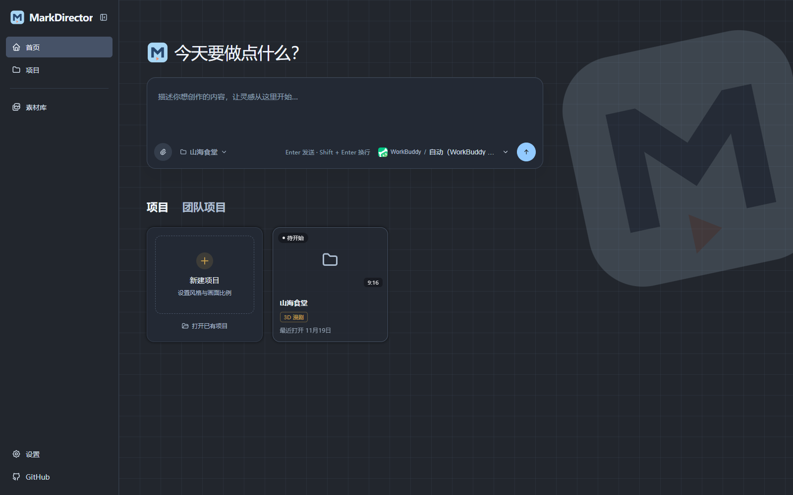
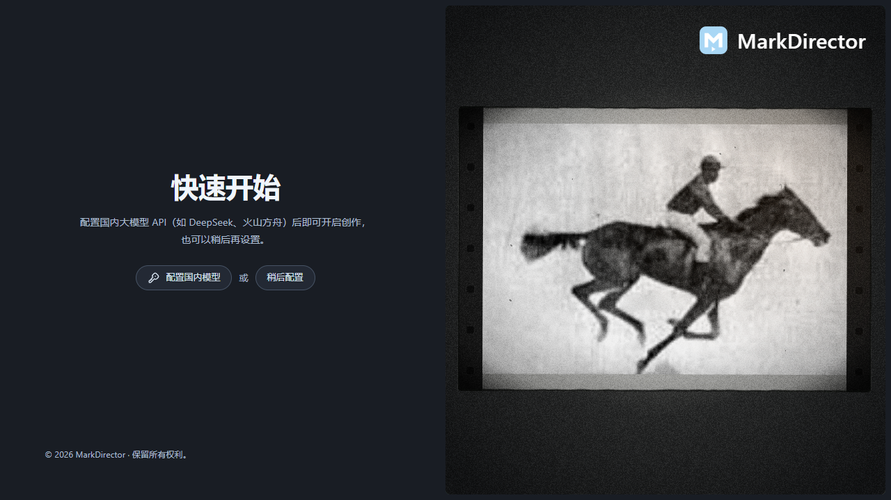
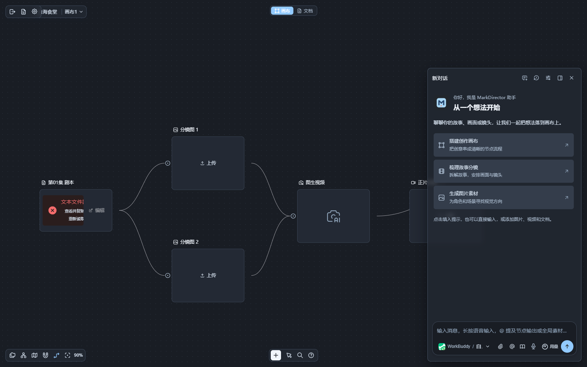
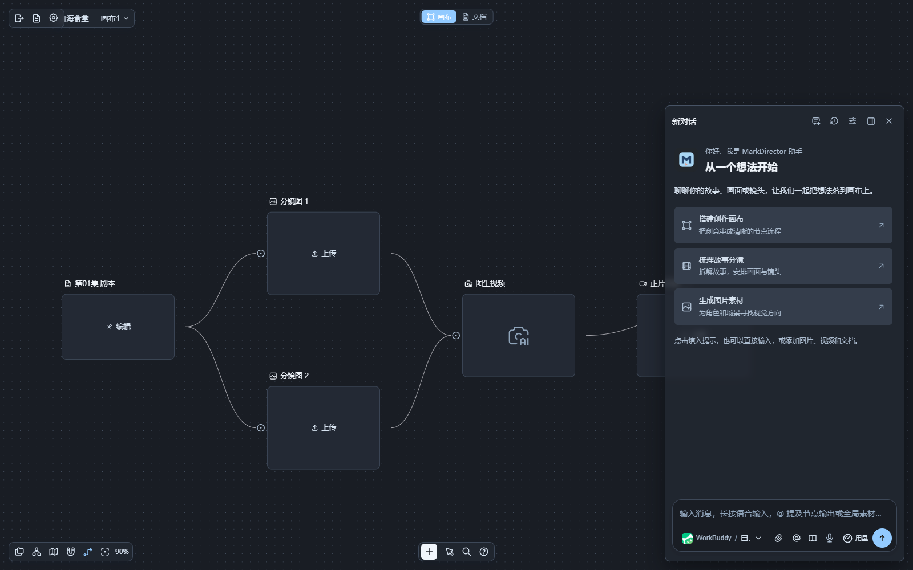

<p>
  <a href="https://github.com/markmushian/MarkDirector">
    
  </a>
</p>

<p align="center">
  <strong>简体中文</strong> |
  <a href="./docs/readme/readmeEn.md">English</a>
</p>

> 🌐 **支持 21 种界面语言** · [查看支持的语言](#languages)

> MarkDirector 是一款免费开源的 AI 漫剧 / 短剧创作桌面工作台：从小说、创意到分集剧本、分镜、资产、图片与视频生成、配音与剪辑合成的完整流水线。基于 MIT 许可开源，参见 [LICENSE](./LICENSE)。

<div align="center">

<p align="center">
  
</p>

<h1 align="center">MarkDirector｜开源 AI 短剧、漫剧与视频创作平台</h1>

<a href="https://git.io/typing-svg">
  <picture>
    <source media="(prefers-color-scheme: dark)" srcset="https://readme-typing-svg.demolab.com?font=Fira+Code&size=30&duration=3000&pause=1000&color=FFFFFF&center=true&vCenter=true&width=480&lines=MarkDirector;AI%E7%9F%AD%E5%89%A7%E5%B7%A5%E5%8E%82;%E8%AE%A9%E7%81%B5%E6%84%9F%E6%88%90%E4%B8%BA%E7%9C%8B%E5%BE%97%E8%A7%81%E7%9A%84%E6%95%85%E4%BA%8B" />
    
  </picture>
</a>

<p align="center">
  <a href="https://github.com/markmushian/MarkDirector/stargazers">
    
  </a>
  <a href="./LICENSE">
    
  </a>
  <a href="https://github.com/markmushian/MarkDirector/releases">
    
  </a>
</p>
<p align="center">
  <a href="https://github.com/markmushian/MarkDirector/network/members">
    
  </a>
</p>
<p align="center">
  <a href="https://github.com/markmushian/MarkDirector/issues">
    
  </a>
  <a href="https://github.com/markmushian/MarkDirector/graphs/contributors">
    
  </a>
  <a href="https://github.com/markmushian/MarkDirector/commits">
    
  </a>
</p>
<p align="center">
  &nbsp;
  &nbsp;
  &nbsp;
  
</p>

MarkDirector 是面向短剧、漫剧和短视频创作者的开源 AI 创作工具。通过无限画布编写剧本与分镜、管理角色和场景素材、生成图片与视频。支持本地部署、自由接入模型，并可通过 AI Agent、MCP 与插件扩展创作流程。

</div>

<p align="center">
  <a href="https://github.com/markmushian/MarkDirector/releases">下载桌面版</a> ·
  <a href="https://github.com/markmushian/MarkDirector/issues">问题反馈</a> ·
  <a href="#languages">支持的语言</a>
</p>

---

## 1. 🌟 亮点

MarkDirector 是面向短剧、漫剧与短视频制作的开源 AI 创作平台，把剧本、资产与视频片段整合进同一张无限画布。

| 能力 | 说明 |
| --- | --- |
| 🏠 **本地部署** | 项目与素材保存在自己的设备或服务器，支持桌面、Android、Docker 与服务器部署。 |
| 🖼️ **无限画布** | 在同一画布中组织剧本、角色、场景与视频片段。 |
| 🔌 **MCP** | 通过 MCP 连接外部工具与服务。 |
| 🧩 **插件系统** | 通过内置插件与自定义扩展增强节点、工具与创作能力。 |
| 🤖 **开放 Agent** | 开放提示词、工具和 A2A，支持自定义 Agent 行为及外部协作。 |
| 🔧 **自由接入模型** | 配置第三方 API，也可接入本地 ComfyUI 和 LLM。 |
| 🌐 **多语言支持** | 支持 21 种界面语言。 |

### 如何用 MarkDirector 制作 AI 短剧与漫剧

1. **编写剧本与分镜**：在文本节点中整理故事、人物设定和镜头描述，使用语言模型辅助创作，再审阅与修改内容。
2. **准备角色与场景素材**：导入参考图片，或通过图片生成节点制作角色、场景和分镜图。
3. **生成视频镜头**：连接文本与图片参考，选择视频模型和生成模式，按镜头生成视频片段。
4. **预览、整理与下载**：在无限画布中预览和组织图片、视频片段，下载素材后按创作需求继续处理。

支持的参考素材、视频时长、分辨率和音频能力取决于所选模型与供应商。

### 常见问题

**MarkDirector 可以用于哪些 AI 短剧和漫剧制作环节？**

MarkDirector 提供文本、图片与视频生成节点，可用于剧本与分镜创作、角色和场景素材制作、视频镜头生成，以及素材的预览与整理。创作者需要审阅和调整内容，具体生成能力取决于配置的模型。

**MarkDirector 免费吗？模型调用需要付费吗？**

MarkDirector 采用 MIT 开源许可，可自行部署。第三方模型服务的 API 调用可能收费；使用本地模型或 ComfyUI 时，需要自行准备相应的运行环境与算力。作品示例中的制作费用仅代表该案例，不是固定价格。

**可以接入自己的模型和 ComfyUI 工作流吗？**

可以配置语言模型与媒体模型服务，也可通过自定义供应商适配接入已有的 ComfyUI 工作流。具体接入方式取决于服务 API、模型与工作流，可参考本文档的安装与配置章节，或通过 [Issues](https://github.com/markmushian/MarkDirector/issues) 咨询。

<a id="languages"></a>

### 多语言支持

支持的语言：简体中文、繁體中文、English、日本語、Русский、Tiếng Việt、ไทย、한국어、हिन्दी、Bahasa Indonesia、Bahasa Melayu、Filipino、বাংলা、اردو、தமிழ்、తెలుగు、मराठी、ਪੰਜਾਬੀ、العربية、فارسی、Türkçe。

---

## 2. 📸 截图

<div align="center">

<a href="./docs/screenshots/home.png"></a><br /><sub>项目首页</sub>

<a href="./docs/screenshots/onboarding.png"></a><br /><sub>首次启动与快速配置</sub>

<a href="./docs/screenshots/script.png"></a><br /><sub>剧本流水线</sub>

<a href="./docs/screenshots/canvas.png"></a><br /><sub>创作画布与 AI Agent</sub>

</div>

---

## 3. 🚀 下载并安装

### 3.1 Windows 桌面版

Windows x64 安装包与绿色版可在 [Releases](https://github.com/markmushian/MarkDirector/releases) 下载；从源码构建见下文。

从源码构建时，先安装工作区依赖并准备 Electrobun SDK：

```powershell
bun install --frozen-lockfile
bun apps/desktop/node_modules/electrobun/bin/electrobun.cjs prepare
bun run build:desktop
```

构建产物位于 `build/desktop/artifacts`。其余平台和服务部署章节供维护者参考。

### 3.2 Docker 安装

先安装 Git、[Docker Engine](https://docs.docker.com/engine/install/) 和 Docker Compose；Windows / macOS 可使用 Docker Desktop 的 Linux 容器模式。仓库提供 [Dockerfile](./Dockerfile)、[Compose 配置](./compose.yaml) 和 [构建排除规则](./.dockerignore)，基于 Bun 1.4.3 构建，镜像内包含 FFmpeg。

<details>
<summary><strong>展开 Docker 安装步骤</strong></summary>

克隆源码后，在仓库根目录执行：

```sh
git clone https://github.com/markmushian/MarkDirector.git
cd MarkDirector
docker compose up -d --build
```

首次构建会安装依赖并编译内置节点、工具、Web 与 Server。启动后访问 `http://127.0.0.1:3000`；远程主机可按下方“访问与数据说明”通过 SSH 隧道访问。首次启动会初始化内置插件，并提供 `myProject` 工作目录。

配置、插件和项目文件保存在 Docker 命名卷 `markdirectorData` 中，挂载至容器的 `/app/data/`。卷的实际名称带有 Compose 项目前缀；停止或重建容器会保留数据，**请勿使用 `docker compose down -v`，该命令会删除数据卷**。

```sh
docker compose logs -f markdirector  # 查看日志
docker compose stop             # 停止服务
docker compose start            # 再次启动
docker compose down             # 删除容器，保留数据卷
```

需要增加项目目录时，可在页面的“选择服务器工作目录”弹窗中点击“新建文件夹”。弹窗也支持文件和文件夹的重命名、删除。也可在服务运行期间通过命令行创建：

```sh
docker compose exec markdirector mkdir -p /app/data/workspaces/newProject
```

备份时先停止服务，复制完成后再启动：

```sh
docker compose stop
docker compose cp markdirector:/app/data ./markdirectorBackup
docker compose start
```

</details>

---

### 3.3 服务器安装

适用于直接在 Linux 服务器上运行 Web 与 Server。以下以 Ubuntu / Debian 为例，使用项目指定的 [Bun 1.4.3](https://bun.sh/docs/installation)。

<details>
<summary><strong>展开服务器安装步骤</strong></summary>

安装运行环境：

```sh
sudo apt-get update
sudo apt-get install -y git curl unzip ffmpeg
curl -fsSL https://bun.com/install | bash -s "bun-v1.4.3"
export PATH="$HOME/.bun/bin:$PATH"
bun --version
```

克隆源码并启动：

```sh
git clone https://github.com/markmushian/MarkDirector.git
cd MarkDirector
bun install --frozen-lockfile

# 构建内置节点、工具、Web 与 Server
bun run build:server
mkdir -p data/workspaces/myProject
bun run start:server
```

看到“服务启动成功”后，可在服务器本机访问 `http://127.0.0.1:3000`。上述命令以前台方式运行，按 `Ctrl+C` 停止；需要开机自启和进程托管时，可参考 [Bun 的 systemd 部署指南](https://bun.sh/guides/ecosystem/systemd)，将工作目录设为仓库目录，启动命令设为 Bun 的绝对路径加 `run start:server`，使用有权读写该目录的用户运行。

</details>

---

### 3.4 访问与数据说明

- 当前服务使用固定端口 `3000`，业务页面与 API 没有独立登录鉴权。服务器安装时，请通过防火墙或安全组限制 `3000` 端口的访问来源；公网访问需配置带认证的反向代理。
- 个人远程使用可在自己的电脑上执行 `ssh -N -L 3000:127.0.0.1:3000 用户名@服务器地址`，保持连接后打开 `http://127.0.0.1:3000`，无需将服务器的 `3000` 端口向公网开放。
- 直接安装时，配置、插件与工作区默认保存在仓库的 `data/`；Docker 安装则保存在数据卷内的 `/app/data/`。迁移或备份时请完整保留。进入页面后选择服务器工作区内的 `myProject`，更多项目可在对应的 `workspaces/` 下创建子目录。
- 两种安装方式均包含系统 FFmpeg。模型服务的 API Key 仍需在页面内配置。

---

## 4. 🎬 作品示例

https://github.com/user-attachments/assets/2d9fddac-dfdf-4640-b030-b09d7f7287e9

### 案例信息

| 项目           | 案例记录                                          |
| -------------- | --------------------------------------------------- |
| 制作周期与成片 | 约 2 小时，成片约 2 分钟。                          |
| 视频模型       | Seedance 2.0                                        |
| 图片模型       | GPT Image 2                                         |
| 语言模型       | Claude Opus 4.6                                     |
| 模型调用费用   | 约 ¥130，其中语言约 ¥10、视频约 ¥120、图片不足 ¥1。 |

费用为该案例的记录，仅供参考，实际成本取决于模型服务、生成次数与参数。演示视频为压缩后的 480p 版本。

---

## 5. 📜 开源许可

MarkDirector 采用 [MIT 许可证](./LICENSE)。第三方依赖和素材遵循各自的许可与版权声明。

[](https://www.star-history.com/#markmushian/MarkDirector&Date)

---

## 6. 🙏 致谢

- **上游项目**：MarkDirector 基于上游开源项目 Toonflow（HBAI-Ltd，MIT 许可）的代码衍生而来，感谢上游作者与所有原贡献者的工作。
- **社区贡献者**：感谢通过 Issue 反馈问题、提交建议与参与共建的所有用户。

<div align="center">

Copyright © 2026 markmushian · MarkDirector 基于 MIT 许可免费开源

</div>


