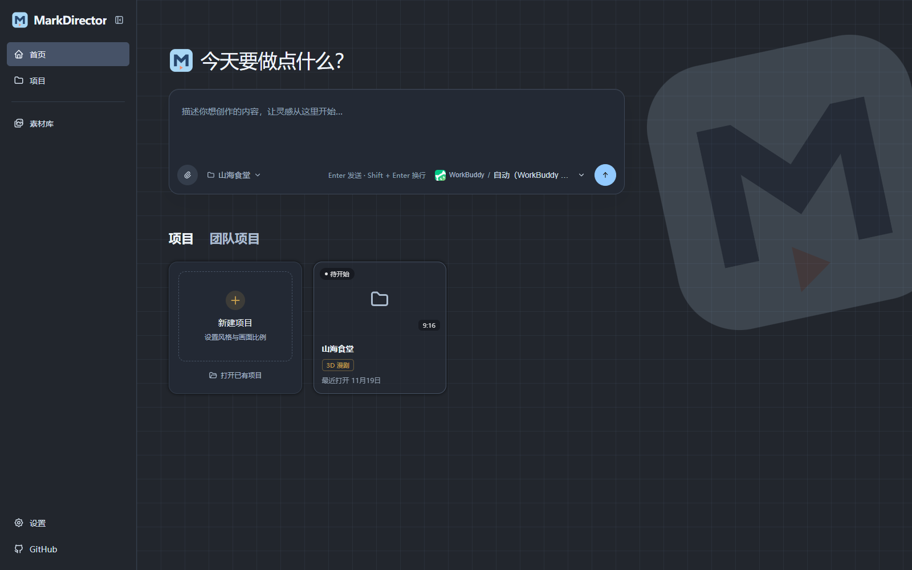
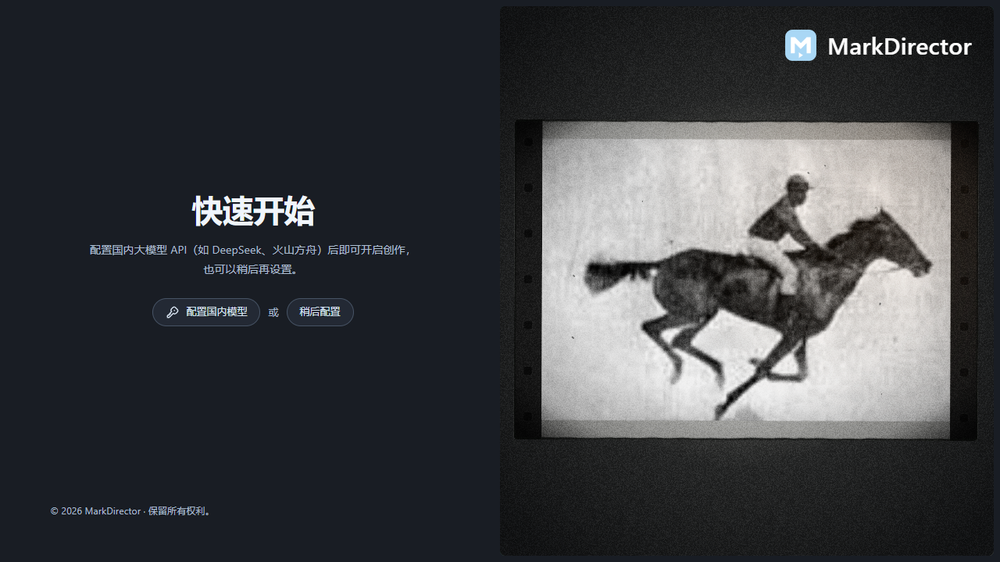
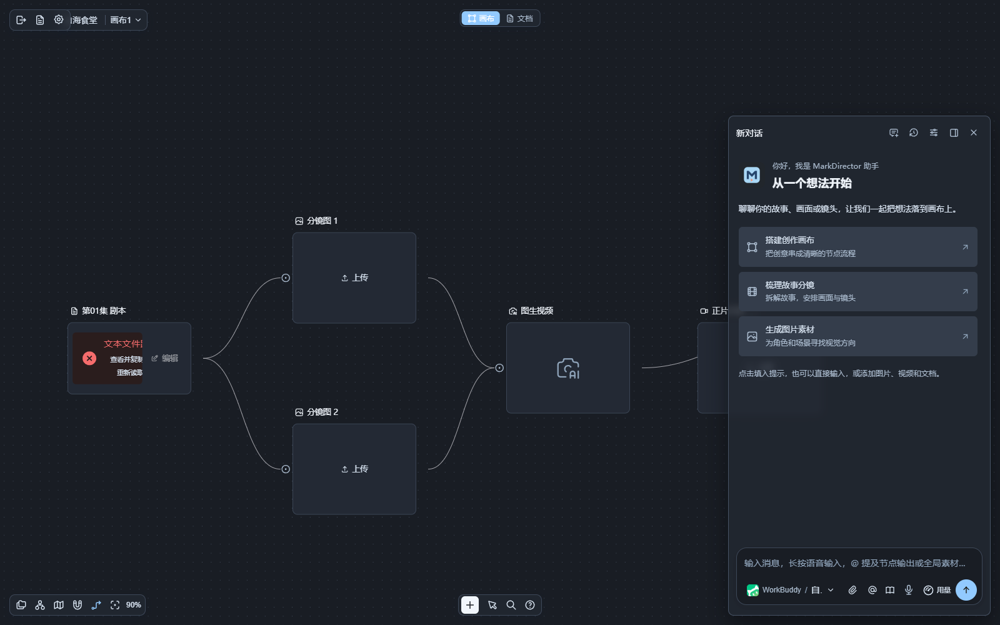
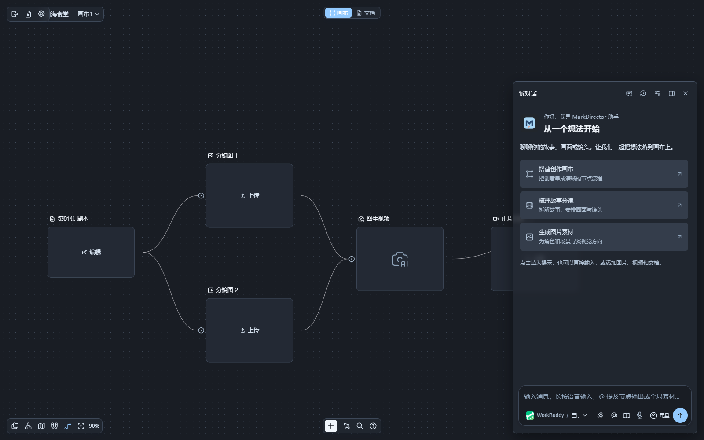

<p>
  <a href="https://github.com/markmushian/MarkDirector">
    
  </a>
</p>

<p align="center">
  <a href="../../README.md">简体中文</a> | <strong>English</strong>
</p>

> 🌐 **21 interface languages** · [View supported languages](#languages)

<div align="center">

<p align="center">
  
</p>

<h1 align="center">MarkDirector | Open-Source AI Short Drama, Animated Comic and Video Creation</h1>

<a href="https://git.io/typing-svg">
  <picture>
    <source media="(prefers-color-scheme: dark)" srcset="https://readme-typing-svg.demolab.com?font=Fira+Code&size=40&duration=3000&pause=1000&color=FFFFFF&center=true&vCenter=true&width=600&lines=MarkDirector;AI%20Short%20Drama%20Studio;Turn%20ideas%20into%20stories" />
    
  </picture>
</a>

<p align="center">
  <a href="https://github.com/markmushian/MarkDirector/stargazers">
    
  </a>
  <a href="../../LICENSE">
    
  </a>
  <a href="https://github.com/markmushian/MarkDirector/releases">
    
  </a>
</p>
<p align="center">
  <a href="https://github.com/markmushian/MarkDirector/network/members">
    
  </a>
</p>
<p align="center">
  <a href="https://github.com/markmushian/MarkDirector/issues">
    
  </a>
  <a href="https://github.com/markmushian/MarkDirector/graphs/contributors">
    
  </a>
  <a href="https://github.com/markmushian/MarkDirector/commits">
    
  </a>
</p>
<p align="center">
  &nbsp;
  &nbsp;
  &nbsp;
  
</p>

MarkDirector is an open-source AI creation tool for short dramas, animated comics and short videos. Write scripts and storyboards, manage character and scene references, and generate images and video clips on an infinite canvas. Deploy it locally, connect the model services you choose, and extend your creative workflow with AI agents, MCP and plugins.

</div>

<p align="center">
  <a href="https://github.com/markmushian/MarkDirector/releases">Download</a> ·
  <a href="https://github.com/markmushian/MarkDirector/issues">Report Issues</a> ·
  <a href="#languages">Supported Languages</a>
</p>

---

## 1. 🌟 Highlights

MarkDirector is an open-source AI creation platform for short dramas, animated comics, and short videos, bringing scripts, assets, and video clips together on one infinite canvas.

| Capability | Description |
| --- | --- |
| 🏠 **Local deployment** | Keep projects and assets on your own device or server, with desktop, Android, Docker, and server deployment options. |
| 🖼️ **Infinite canvas** | Organize scripts, characters, scenes, and video clips on the same canvas. |
| 🔌 **MCP** | Connect external tools and services through MCP. |
| 🧩 **Plugins** | Extend nodes, tools, and creative capabilities with bundled plugins and custom extensions. |
| 🤖 **Open Agent** | Open access to prompts, tools, and A2A to customize Agent behavior and collaborate with external Agents. |
| 🔧 **Flexible model integration** | Configure third-party APIs or connect local ComfyUI instances and LLMs. |
| 🌐 **Multilingual support** | Supports 21 interface languages. |

### How to Create AI Short Dramas and Animated Comics with MarkDirector

1. **Write scripts and storyboards**: Develop your story, character descriptions and shot descriptions in text nodes, using a language model for assistance before reviewing and editing the results.
2. **Prepare character and scene references**: Import reference images or use image generation nodes to create character, scene and storyboard images.
3. **Generate video shots**: Connect text and image references, select a video model and generation mode, and generate individual clips.
4. **Preview, organize and download**: Preview and arrange images and video clips on the infinite canvas, then download the assets for further production work.

Supported references, video durations, resolutions and audio capabilities depend on the selected model and provider.

### Frequently Asked Questions

**Which stages of AI short drama and animated comic production does MarkDirector support?**

Text, image and video generation nodes support script and storyboard development, character and scene asset creation, video-shot generation, and asset preview and organization. Creators need to review and refine the results. Available generation features depend on the configured models.

**Is MarkDirector free? Do model calls cost money?**

MarkDirector is open source under the MIT License and can be self-hosted. Third-party model APIs may charge usage fees. Local models and ComfyUI require your own runtime environment and computing resources. The production costs shown in the example apply only to that project and are not a fixed price.

**Can I connect my own models and ComfyUI workflows?**

You can configure language and media model services and use custom provider adapters to connect existing ComfyUI workflows. The integration depends on the service API, model and workflow. See the installation and configuration sections above, or ask via [Issues](https://github.com/markmushian/MarkDirector/issues).

<a id="languages"></a>

### Multilingual support

Supported languages: 简体中文, 繁體中文, English, 日本語, Русский, Tiếng Việt, ไทย, 한국어, हिन्दी, Bahasa Indonesia, Bahasa Melayu, Filipino, বাংলা, اردو, தமிழ், తెలుగు, मराठी, ਪੰਜਾਬੀ, العربية, فارسی, Türkçe.

---

## 2. 📸 Screenshots

<div align="center">

<a href="../screenshots/home.png"></a><br /><sub>Project home</sub>

<a href="../screenshots/onboarding.png"></a><br /><sub>First launch and quick setup</sub>

<a href="../screenshots/script.png"></a><br /><sub>Script pipeline</sub>

<a href="../screenshots/canvas.png"></a><br /><sub>Creative canvas and AI Agent</sub>

</div>

---

## 3. 🚀 Download and Install

### 3.1 Client Installation

| Operating System | GitHub |
| --- | --- |
| Windows | [Release](https://github.com/markmushian/MarkDirector/releases) |
| macOS | [Release](https://github.com/markmushian/MarkDirector/releases) |
| Android ARM64 | [Download APK](https://github.com/markmushian/MarkDirector/releases/latest) |

The Android app supports ARM64 devices only. Download and install `markdirector-VERSION-android-arm64.apk` from the release page. It includes a local Bun backend and can run independently, or use Device Link on the home page to scan a QR code or manually connect to a computer or remote backend with sharing enabled, over a local network or the internet.

The Windows installer automatically detects and installs WebView2. If the app closes immediately after installation, download and install the runtime manually from the [WebView2 download page](https://developer.microsoft.com/microsoft-edge/webview2/).

On macOS (Apple Silicon), drag MarkDirector into Applications and open it directly. No terminal commands are required beforehand. If macOS displays a security warning, follow the steps below in order.

<details>
<summary><strong>If MarkDirector cannot be installed or opened on macOS</strong></summary>

**1. Allow MarkDirector in Privacy & Security**

If you see a warning that the developer cannot be verified or that Apple cannot check the app for malicious software, first try opening MarkDirector. Then go to System Settings → Privacy & Security, find the message stating that MarkDirector was blocked, click Open Anyway, and confirm as prompted. See [Apple's official instructions](https://support.apple.com/zh-cn/102445).

**2. If quarantine restrictions still prevent opening, try removing the quarantine attribute**

After confirming that the app came from the official release page and is in Applications, run the following command in Terminal and try opening it again. Adjust the path if the app name or installation location differs.

```bash
sudo xattr -rd com.apple.quarantine /Applications/markdirector.app
```

**3. Last resort: temporarily allow apps from anywhere**

If neither of the first two methods works and you trust the source of the app, try running:

```bash
sudo spctl --master-disable
```

Then open System Settings → Privacy & Security. Under Security, set “Allow applications downloaded from” to “Anywhere” if your system offers that option, and confirm as prompted. Available options and command support may vary across macOS versions.

This relaxes security restrictions for all apps. Afterward, we recommend restoring the setting to “App Store and identified developers.”

</details>

For more instructions, see the sections above or the notes on the [Releases](https://github.com/markmushian/MarkDirector/releases) page.

---

### 3.2 Docker Installation

Install Git, [Docker Engine](https://docs.docker.com/engine/install/), and Docker Compose first. On Windows and macOS, you can use Docker Desktop in Linux container mode. The repository includes a [Dockerfile](../../Dockerfile), [Compose configuration](../../compose.yaml), and [build exclusions](../../.dockerignore). The image is built with Bun 1.4.3 and includes FFmpeg.

<details>
<summary><strong>Expand Docker installation steps</strong></summary>

Clone the source and run the following in the repository root:

```sh
git clone https://github.com/markmushian/MarkDirector.git
cd MarkDirector
docker compose up -d --build
```

The first build installs dependencies and builds the bundled nodes, tools, Web, and Server. Once started, open `http://127.0.0.1:3000`. For a remote host, use an SSH tunnel as described under “Access and Data” below. The first startup initializes the bundled plugins and provides a `myProject` working directory.

Settings, plugins, and project files are stored in the Docker named volume `markdirectorData`, mounted at `/app/data/` inside the container. The actual volume name includes the Compose project prefix. Stopping or rebuilding the container preserves your data. **Do not use `docker compose down -v`: this command deletes the data volume.**

```sh
docker compose logs -f markdirector  # View logs
docker compose stop             # Stop the service
docker compose start            # Start it again
docker compose down             # Remove containers, retaining the data volume
```

To add a project directory, click “New Folder” in the “Select Server Working Directory” dialog. The dialog also supports renaming and deleting files and folders. Alternatively, create a directory from the command line while the service is running:

```sh
docker compose exec markdirector mkdir -p /app/data/workspaces/newProject
```

For a backup, stop the service first, copy the data, then restart it:

```sh
docker compose stop
docker compose cp markdirector:/app/data ./markdirectorBackup
docker compose start
```

</details>

---

### 3.3 Server Installation

Use this option to run Web and Server directly on a Linux server. The example below uses Ubuntu / Debian and the project's specified version, [Bun 1.4.3](https://bun.sh/docs/installation).

<details>
<summary><strong>Expand server installation steps</strong></summary>

Install the runtime environment:

```sh
sudo apt-get update
sudo apt-get install -y git curl unzip ffmpeg
curl -fsSL https://bun.com/install | bash -s "bun-v1.4.3"
export PATH="$HOME/.bun/bin:$PATH"
bun --version
```

Clone the source and start the service:

```sh
git clone https://github.com/markmushian/MarkDirector.git
cd MarkDirector
bun install --frozen-lockfile

# Build bundled nodes, tools, Web, and Server
bun run build:server
mkdir -p data/workspaces/myProject
bun run start:server
```

When you see “服务启动成功” (service started successfully), open `http://127.0.0.1:3000` on the server itself. The command above runs in the foreground; press `Ctrl+C` to stop it. For startup at boot and process management, see [Bun's systemd deployment guide](https://bun.sh/guides/ecosystem/systemd). Set the working directory to the repository directory and the start command to the absolute path of Bun followed by `run start:server`. Run it as a user with read and write access to that directory.

</details>

---

### 3.4 Access and Data

- The service currently uses the fixed port `3000`. The web interface and API do not have separate login authentication. For server installations, restrict access to port `3000` through a firewall or security group. Public access requires a reverse proxy with authentication.
- For personal remote access, run `ssh -N -L 3000:127.0.0.1:3000 username@server-address` on your own computer. Keep the connection open, then visit `http://127.0.0.1:3000`. You do not need to expose the server's port `3000` to the public internet.
- With direct installation, settings, plugins, and workspaces are stored in the repository's `data/` directory by default. With Docker, they are stored at `/app/data/` inside the data volume. Preserve the entire directory when migrating or backing up. After opening the page, select `myProject` in the server workspace. Create subdirectories under the corresponding `workspaces/` directory for additional projects.
- Both installation methods include system FFmpeg. You still need to configure API keys for model services in the interface.

---

## 4. 🎬 Example Work

https://github.com/user-attachments/assets/2d9fddac-dfdf-4640-b030-b09d7f7287e9

### Production Details

| Item | Details |
| --- | --- |
| Production time and final length | Approximately 2 hours of work for a video of about 2 minutes. |
| Video model | Seedance 2.0 |
| Image model | GPT Image 2 |
| Language model | Claude Opus 4.6 |
| Model API costs | Approximately ¥130 CNY (Chinese yuan): about ¥10 for language, ¥120 for video, and less than ¥1 for images. |

These costs are the recorded figures for this example and are provided for reference only. Actual costs depend on the model service, number of generations, and parameters. The demo video is a compressed 480p version.

---

## 5. 📜 Open-Source License

MarkDirector is licensed under the [MIT License](../../LICENSE). Third-party dependencies and assets remain subject to their respective licenses and copyright notices.

[](https://www.star-history.com/#markmushian/MarkDirector&Date)

---

## 6. 🙏 Acknowledgments

- **Upstream project**: MarkDirector is derived from the upstream open-source project Toonflow by HBAI-Ltd (MIT licensed). Thanks to the upstream authors and all original contributors.
- **Community contributors**: Thank you to everyone who reports issues, shares suggestions, and helps improve the project.

<div align="center">

Copyright © 2026 markmushian · MarkDirector is free and open source under the MIT License

</div>


